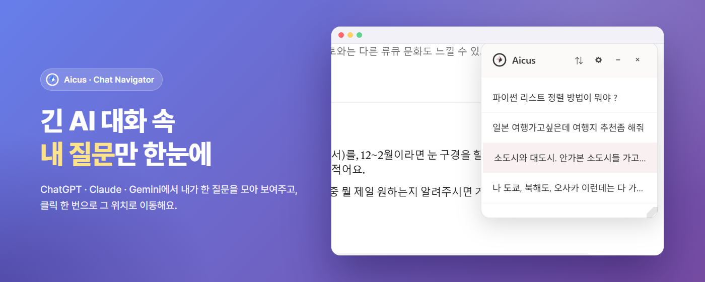
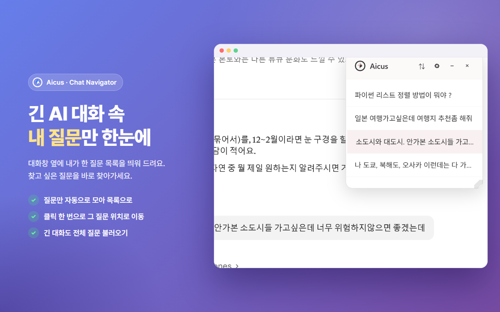
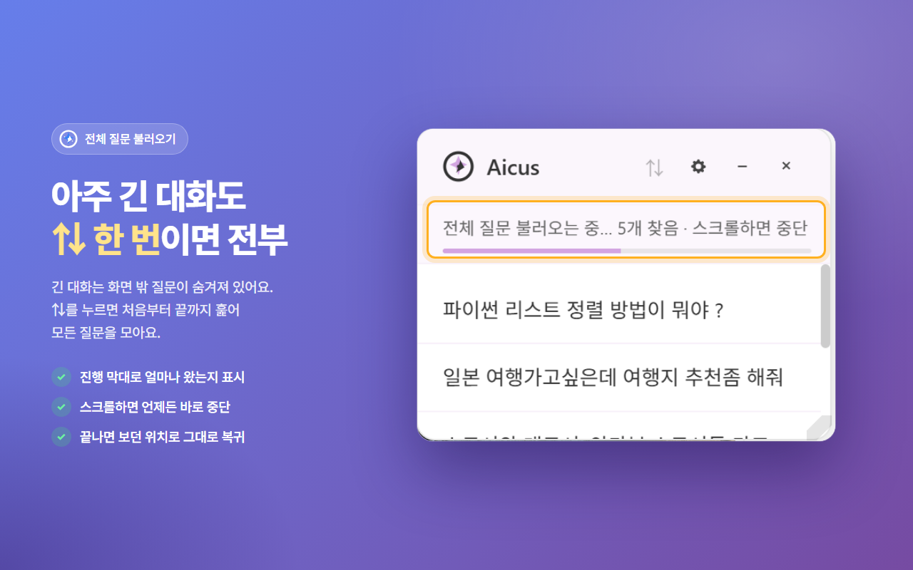
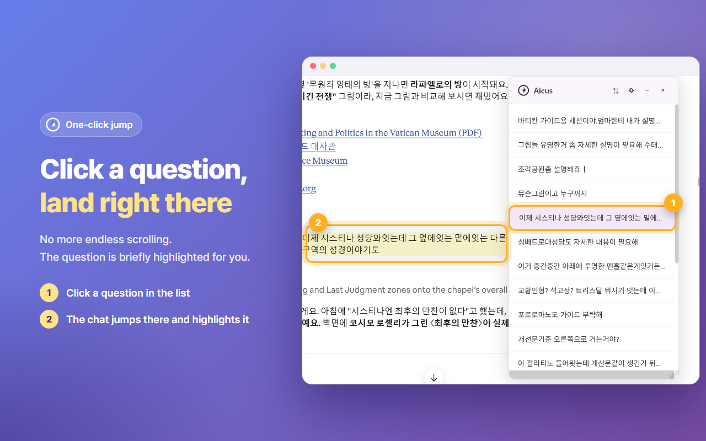
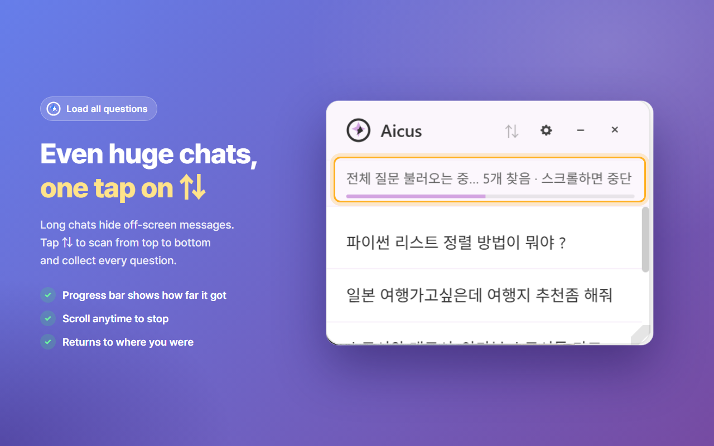
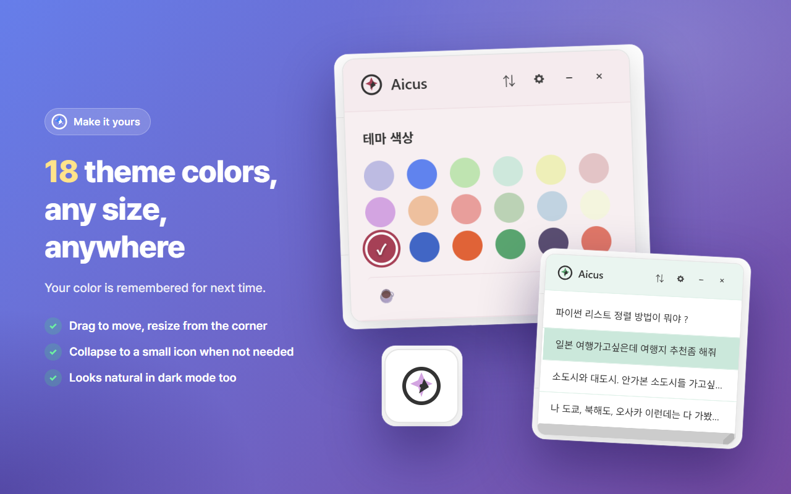
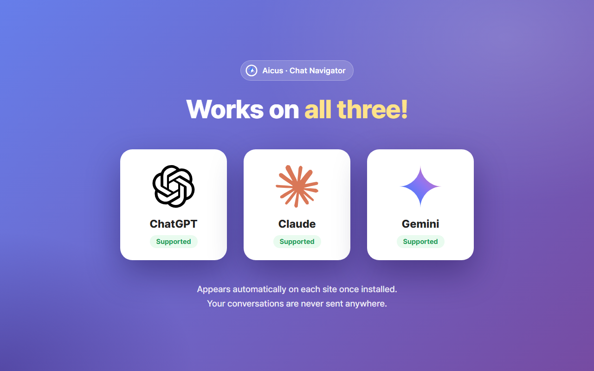

# Aicus - Chat Navigator


**한국어** | [English](#english)



**Aicus**는 ChatGPT, Claude, Gemini 대화창 옆에 **내가 한 질문만** 모아 보여주고,
클릭 한 번으로 그 질문 위치로 이동할 수 있게 해주는 Chrome 확장 프로그램입니다.

[**Chrome 웹스토어에서 설치하기**](https://chromewebstore.google.com/detail/ndjlfdeoiagafmfbbbfhjoejdlcmhpdl)

---

## 주요 기능

### 1. 긴 대화 속 내 질문만 한눈에
대화창 옆에 내가 한 질문 목록을 띄워 줍니다. 답변 사이에 묻힌 질문을 스크롤로 찾을 필요가 없어요.



### 2. 질문을 누르면 그 자리로 바로
목록에서 질문을 누르면 대화가 그 위치로 이동하고, 해당 질문이 잠깐 강조됩니다.


### 3. 아주 긴 대화도 ⇅ 한 번이면 전부
Claude·ChatGPT는 긴 대화에서 화면 밖 메시지를 숨겨 둡니다. ⇅를 누르면 처음부터 끝까지 훑어 모든 질문을 모읍니다.
- 진행 막대로 얼마나 왔는지 표시
- 스크롤하면 언제든 바로 중단
- 끝나면 보던 위치로 그대로 복귀



### 4. 내 취향대로
- 18가지 테마 색상 (고른 색은 다음 방문에도 기억)
- 드래그로 위치, 모서리로 크기 조절
- 필요 없을 땐 작은 아이콘으로 접기
- 다크 모드 지원


### 5. ChatGPT · Claude · Gemini 모두 지원
설치만 하면 각 사이트에서 자동으로 나타납니다.


---

## 설치 방법

### Chrome 웹스토어
- [Aicus - Chrome 웹스토어](https://chromewebstore.google.com/detail/ndjlfdeoiagafmfbbbfhjoejdlcmhpdl)

### 개발 모드로 직접 설치
1. 이 저장소를 내려받거나 ZIP으로 받아 압축 해제
2. `chrome://extensions` 접속
3. **개발자 모드** ON → **압축해제된 확장 프로그램 로드** → 이 폴더 선택
4. ChatGPT / Claude / Gemini 페이지에서 동작 확인

---

## 폴더 구조
```
aicus-extension/
├─ manifest.json      # MV3 설정 (권한: activeTab)
├─ content.js         # 질문 수집, 패널 UI, 전체 질문 불러오기
├─ popup.html / .js   # 툴바 팝업
├─ icons/             # 확장 아이콘
├─ docs/              # 후원 QR 이미지 (확장에 포함)
└─ assets/readme/     # README용 이미지 (확장에 포함되지 않음)
```

---

## 개발 관련
- Manifest V3, 빌드 도구 없는 순수 JavaScript
- 사이트별 선택자는 `content.js` 맨 위 `SITES` 설정에 모여 있습니다
- 진단 로그: 사이트 콘솔에서 `localStorage.aicusDebug = '1'` 입력 후 새로고침 (개수·시간만 기록, 대화 내용은 기록하지 않음)

---

## 개인정보 & 데이터 처리
- 이 확장 프로그램은 **사용자 데이터를 수집하지 않습니다.**
- 질문 목록은 브라우저 메모리 안에서만 처리되며, **외부 서버로 아무것도 전송하지 않습니다.**
- 고른 테마 색상만 해당 사이트의 브라우저 저장소(localStorage)에 저장됩니다.

---

## 라이선스
무단 상업배포, 이용을 금합니다. 개인사용자는 언제나 ✨무료✨!!
*수정, 건의요청, PR, 기능개선은 언제나 환영합니다*

문의 : pikiforyou@gmail.com

---

<a id="english"></a>

# English


**Aicus** is a Chrome extension that collects **only your questions** next to ChatGPT, Claude and Gemini chats,
and jumps to any of them in one click.

[**Install from the Chrome Web Store**](https://chromewebstore.google.com/detail/ndjlfdeoiagafmfbbbfhjoejdlcmhpdl)

## Features

### 1. All your questions in long AI chats
A floating list of everything you asked, right next to the chat.


### 2. Click a question, land right there
The chat jumps to the question and briefly highlights it.



### 3. Even huge chats, one tap on ⇅
Claude and ChatGPT hide off-screen messages in long chats. Tap ⇅ to scan from top to bottom and collect every question.
- Progress bar shows how far it got
- Scroll anytime to stop
- Returns to where you were



### 4. Make it yours
- 18 theme colors (remembered for next time)
- Drag to move, resize from the corner
- Collapse to a small icon when not needed
- Dark mode support



### 5. Works on ChatGPT · Claude · Gemini



## Privacy
- Aicus **does not collect any user data** and **sends nothing to external servers.**
- Only your chosen theme color is saved in the site's browser storage (localStorage).

## Contact
pikiforyou@gmail.com
